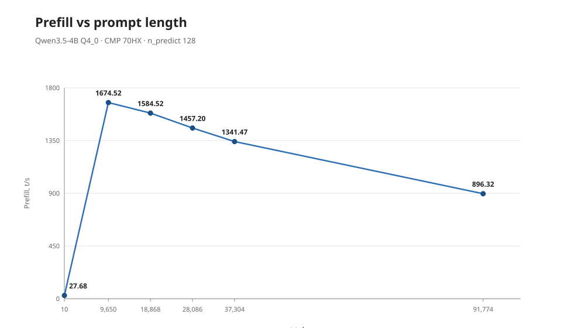
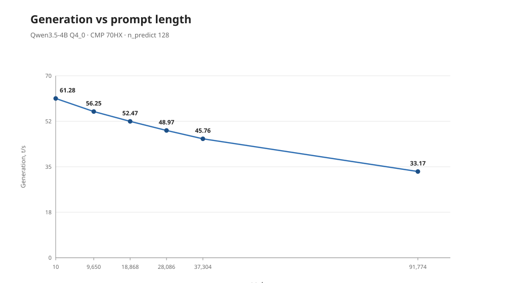
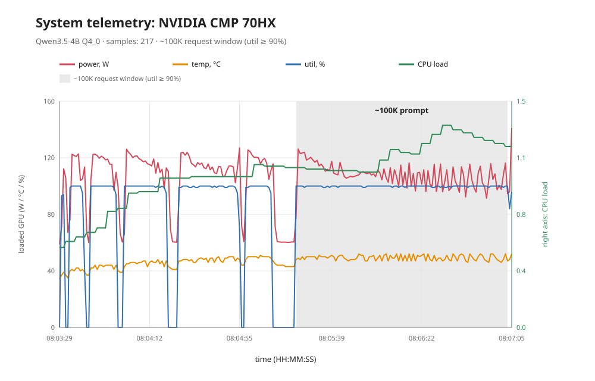
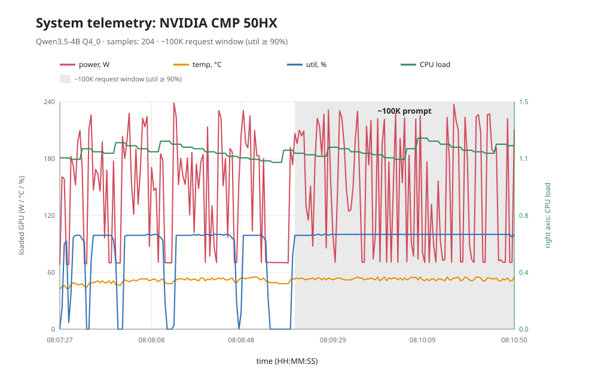
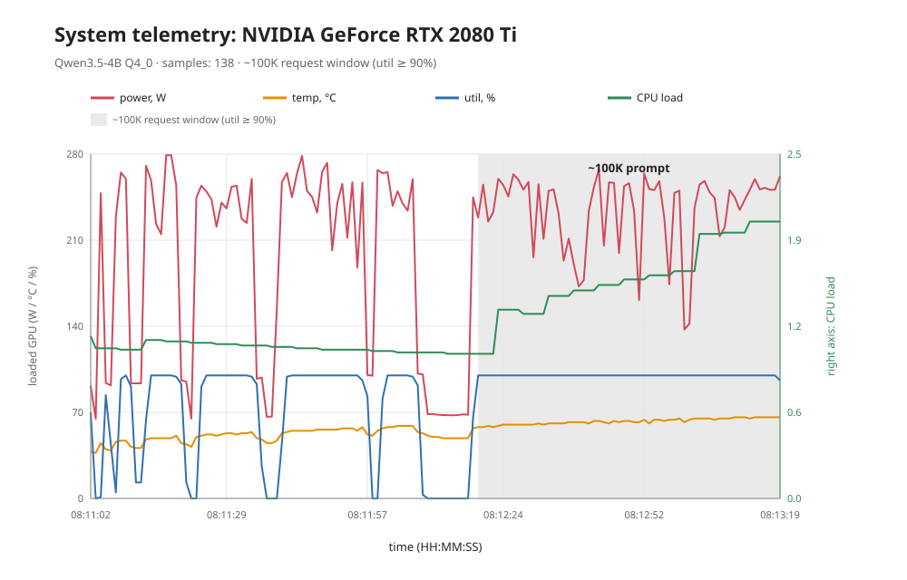
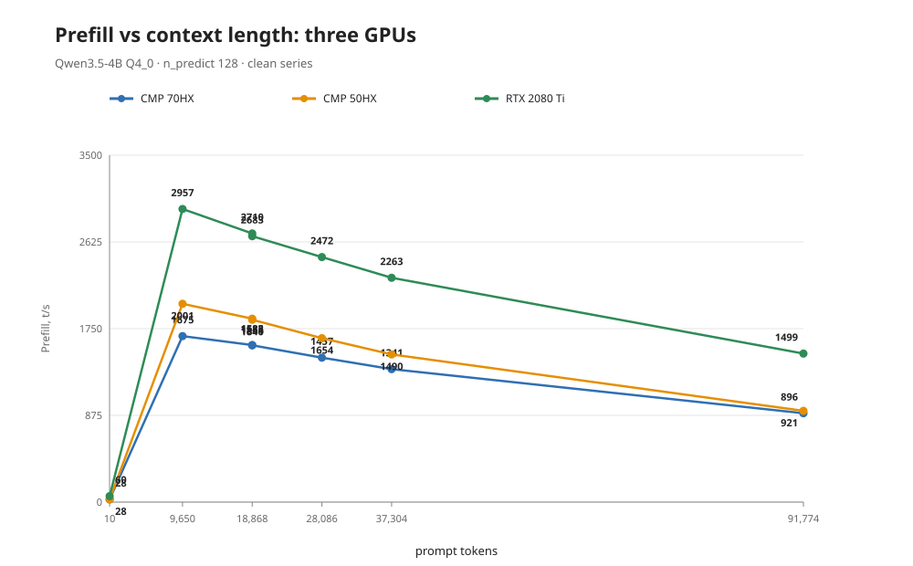
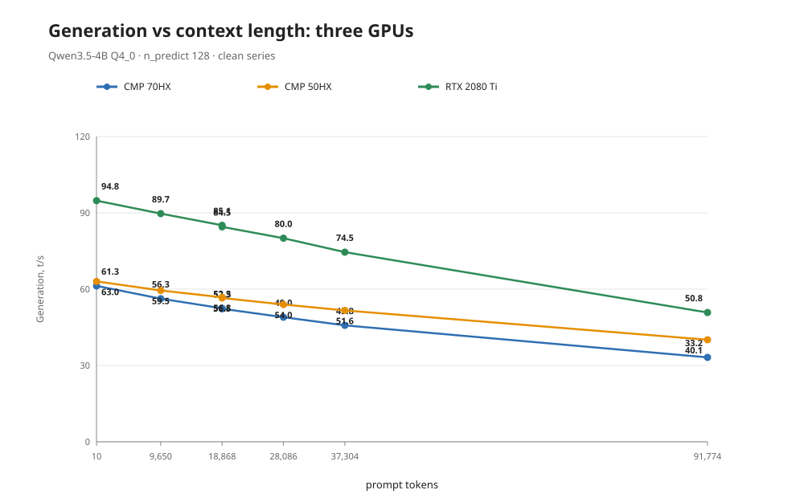
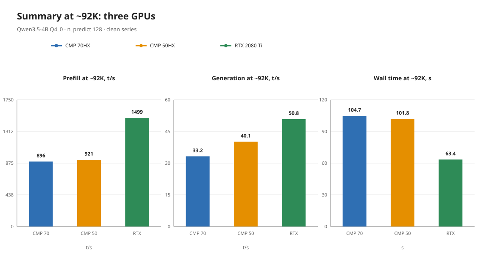
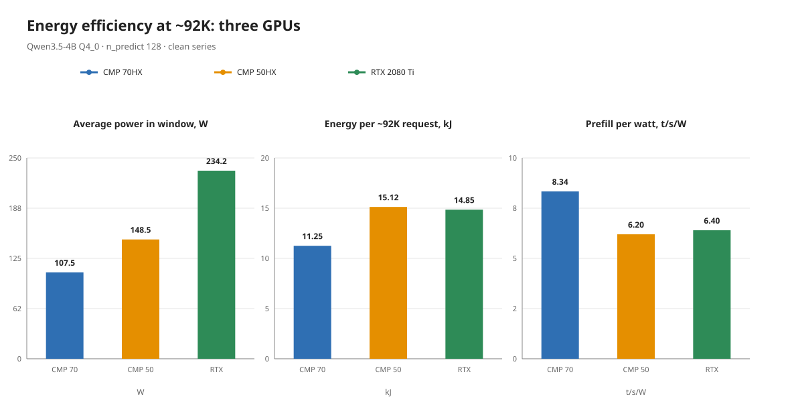

# Qwen3.5-4B (Q4_0 + vision): 128K context and a CMP 70HX / CMP 50HX / RTX 2080 Ti comparison

[Русский](README.md) | **English**

## ⚠️ Disclaimer

The case contains measurements, descriptions and our own scripts only. Model
weights and the mmproj are **not included** — only sha256 is published. Third
party binaries and third party scripts are not part of the distribution. CMP
70HX unlocking lives in a separate repository
[inference-cmp70-tuning](https://github.com/Manglobite/inference-cmp70-tuning);
here an already unlocked card is used.

## Goal

Test the hybrid Qwen3.5-4B (Gated DeltaNet + full attention) on an unlocked CMP
70HX: how much context fits with a Q4 model and KV q8_0, how prefill/gen
degrade, and what the telemetry of a tight single-card run looks like.

## Main result

`--ctx-size 131072` with the vision projector loaded fits into the 8 GiB card
with ~1.6 GiB to spare: peak VRAM 6518 MiB out of 8192. Prefill drops from
1674.52 t/s at ~9.6K tokens to 896.32 t/s at ~91.8K; generation goes from 61.28
to 33.17 t/s. Peaks of 52 °C and 141.06 W, 0 errors.

In the clean series the RTX 2080 Ti is the fastest (prefill ×1.67
and gen ×1.53 versus the CMP 70HX at ~92K), the CMP 70HX is the most
power-efficient (8.34 t/s/W) and the coolest (52 °C), and the CMP 50HX is close
to the CMP 70HX in speed but ~1.4× more power-hungry.

## Hardware and software

- GPU: **NVIDIA CMP 70HX 8 GiB** (unlocked, see the
  [inference-cmp70-tuning](https://github.com/Manglobite/inference-cmp70-tuning)
  repository).
- Driver 610.43.03, kernel 7.0.0-34-generic.
- Runtime: llama.cpp, commit **df03399**.
- Model: `Qwen3.5-4B-Q4_0.gguf` — 2,583,221,408 B,
  sha256 `298fcb5fe7a77ccc79745ae24751560c5ac56874caff4bb39b1f2055bd72b8bb`.
- Projector: `mmproj-Qwen3.5-4B-F16.gguf` — 672,423,616 B,
  sha256 `cd88edcf8d031894960bb0c9c5b9b7e1fea6ebee02b9f7ce925a00d12891f864`.
- Weights are not published; the case carries provenance only (size and
  sha256).

## Launch configuration

- Single card: CMP 70HX (CUDA0).
- `--ctx-size 131072`, `--cache-type-k q8_0 --cache-type-v q8_0`.
- `--mmproj` + `--mmproj-device CUDA0`.
- `-ngl all`, flash-attn, ubatch 448, port 8087.
- The model's native maximum is 262,144; KV/token is ≈17 KiB in q8_0 thanks to
  the hybrid layout: only 8 full-attention layers out of 32 (4 KV heads ×
  head_dim 256).

## Results: the ladder

| target | prompt_n | prompt t/s | predicted_n | predicted t/s | wall |
| ---: | ---: | ---: | ---: | ---: | ---: |
| 0 | 10 | 27.68 | 128 | 61.28 | 2.44 |
| 10000 | 9650 | 1674.52 | 87 | 56.25 | 7.74 |
| 20000 | 18868 | 1584.52 | 79 | 52.47 | 13.53 |
| 30000 | 28086 | 1457.20 | 81 | 48.97 | 21.12 |
| 40000 | 37304 | 1341.47 | 82 | 45.76 | 29.77 |
| 20000 | 18868 | 1581.66 | 79 | 52.29 | 13.57 |
| 100000 | 91774 | 896.32 | 62 | 33.17 | 104.66 |

Clean series 06.10.2026, run `cmp70`, 217 telemetry samples, 0 errors.





## System telemetry

- Samples: 217.
- GPU util: max 100%.
- GPU temperature: max 52 °C.
- GPU power: max 141.06 W (average in the ~100K window — 107.53 W).
- VRAM: max 6518 MiB.
- CPU load average: max 1.34; CPU temperature max 43 °C.
- RAM: max 4.78 of 32.9 GiB.
- Clocks: 1545 MHz core / 9501 MHz memory.



*CMP 70HX.*



*CMP 50HX.*



*RTX 2080 Ti.*

## GPU comparison: CMP 70HX / CMP 50HX / RTX 2080 Ti

Clean series: three back-to-back runs with restart, no other workloads; same
model/context 131072/KV q8_0/vision/
prompts/telemetry; cards one after another.

| Metric | CMP 70HX | CMP 50HX | RTX 2080 Ti |
| --- | ---: | ---: | ---: |
| Prefill @ ~9.6K, t/s | 1674.52 | 2000.77 | 2957.14 |
| Prefill @ ~37.3K, t/s | 1341.47 | 1489.83 | 2263.17 |
| Prefill @ ~91.8K, t/s | 896.32 | 920.77 | 1498.54 |
| Generation @ ~9.6K, t/s | 56.25 | 59.48 | 89.70 |
| Generation @ ~91.8K, t/s | 33.17 | 40.11 | 50.81 |
| ~100K request time, s | 104.66 | 101.81 | 63.41 |
| Average power in the ~100K window, W | 107.53 | 148.55 | 234.16 |
| Energy per ~100K, kJ | 11.25 | 15.12 | 14.85 |
| Prefill@92K per watt, t/s/W | 8.34 | 6.20 | 6.40 |
| Peak temperature, °C | 52 | 55 | 66 |









## Limitations and caveats

- The actual `prompt_n` is 4–8% below target — a harness quirk, accepted as is
  (target sets the requested prefix size, not an exact token count).
- Answers are short (they stop on EOS, `predicted_n` 62–128), so the gen numbers
  come from short tails and are not a long decode benchmark.
- 256K context was not tested.
- Vision input was not tested: the projector is loaded, but no images were fed.
- The comparison with 7B lives in a different case.
- The GPU comparison is a single series (three back-to-back runs) that spans
  different architectures (sm_86 vs sm_75) and different TDPs; average power is
  measured in the ~100K request window (util ≥ 90); the CMP 50HX is unlocked;
  the RTX is stock.

## Case layout

```text
qwen35-4b/
├── README.md / README.en.md     <- this file (EN) and the Russian default
├── LICENSE-NOTICE.md            <- what is not included
├── data/
│   ├── prefill-vs-context.ru.svg
│   ├── gen-vs-context.ru.svg
│   ├── system-telemetry-cmp70.ru.svg
│   ├── system-telemetry-cmp50.ru.svg
│   ├── system-telemetry-rtx.ru.svg
│   ├── prefill-vs-context-3gpu.ru.svg
│   ├── gen-vs-context-3gpu.ru.svg
│   ├── throughput-summary-3gpu.ru.svg
│   ├── energy-efficiency-3gpu.ru.svg
│   ├── prefill-vs-context.en.svg
│   ├── gen-vs-context.en.svg
│   ├── system-telemetry-cmp70.en.svg
│   ├── system-telemetry-cmp50.en.svg
│   ├── system-telemetry-rtx.en.svg
│   ├── prefill-vs-context-3gpu.en.svg
│   ├── gen-vs-context-3gpu.en.svg
│   ├── throughput-summary-3gpu.en.svg
│   └── energy-efficiency-3gpu.en.svg
└── scripts/
    └── check-public.sh          <- publication barrier
```

## Publication

`bash scripts/check-public.sh` → OK. The case uses relative paths only; model
weights and the projector appear solely as sha256. The `scripts/check-public.sh`
barrier checks not only private markers (paths, IP/hosts, session IDs, keys) but
also the **inventory**: only the README (RU/EN), LICENSE-NOTICE.md, .gitignore,
scripts/check-public.sh and `data/*.svg` are allowed; a public link to the
companion case repository is permitted as a targeted exception. There is a
self-test: `python3 scripts/check-public-selftest.py` (in the root `scripts/`).
