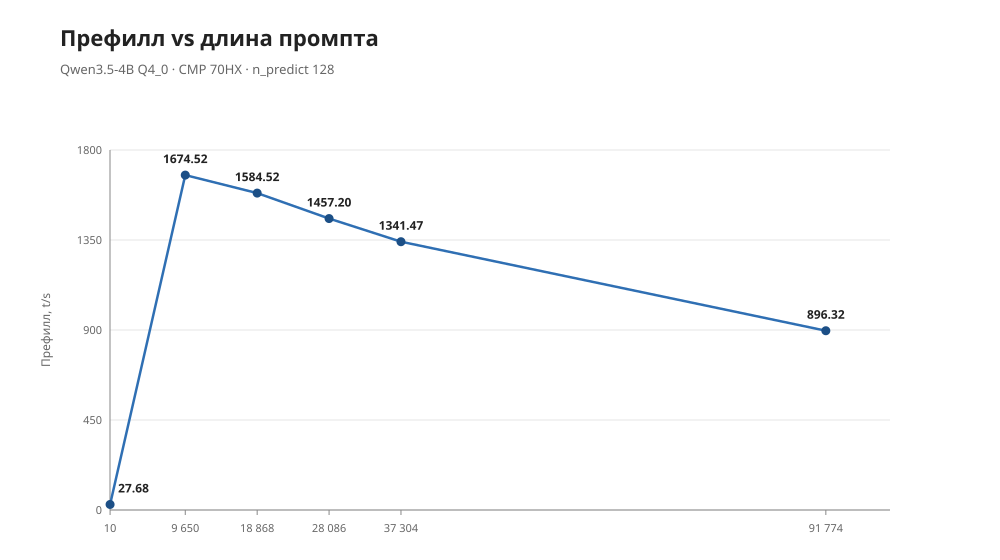
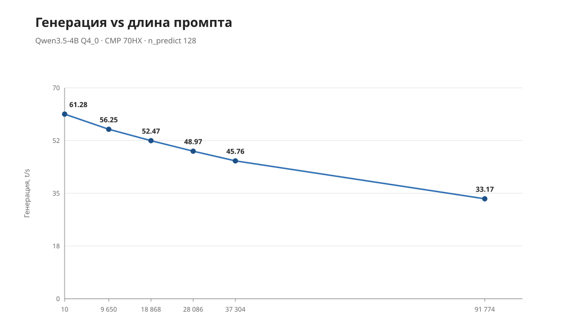
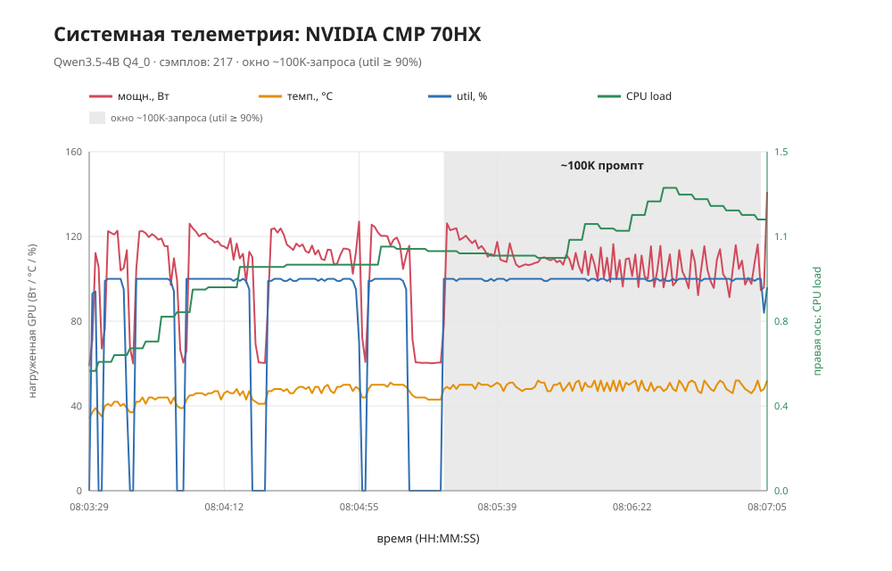
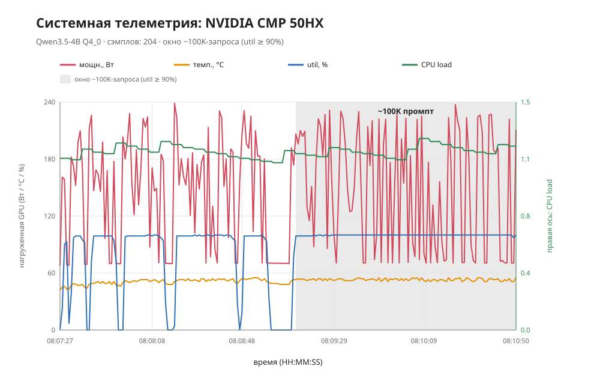
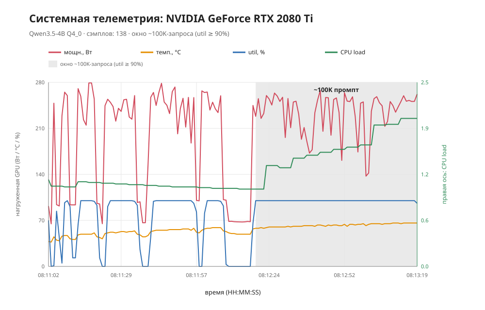
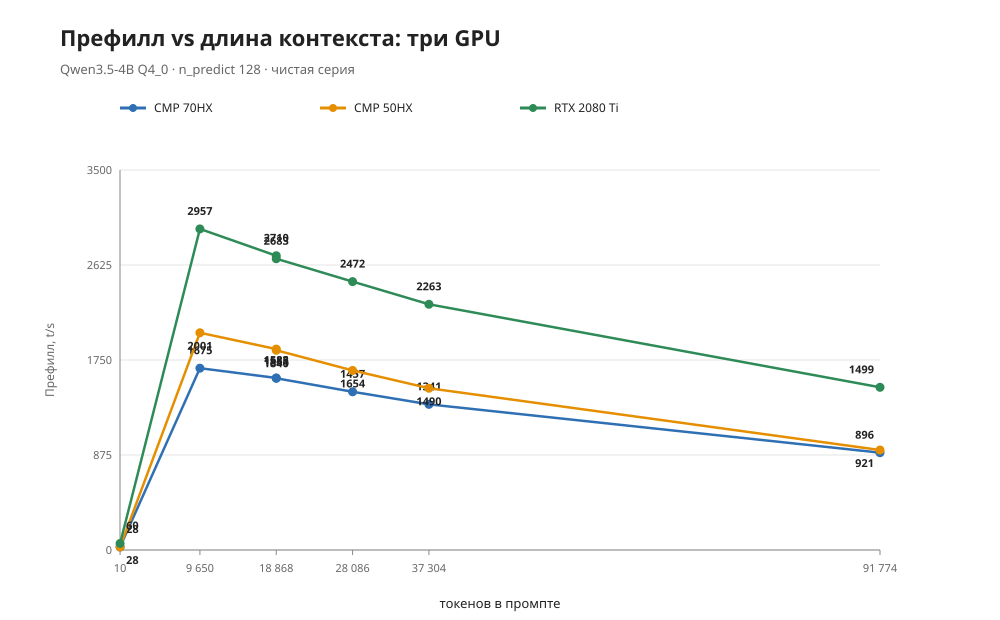
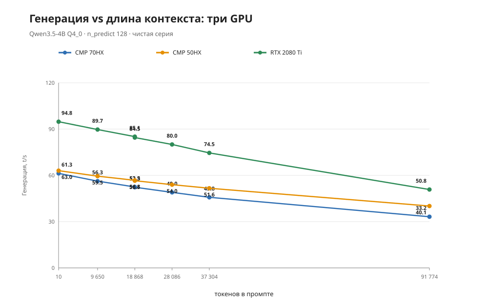
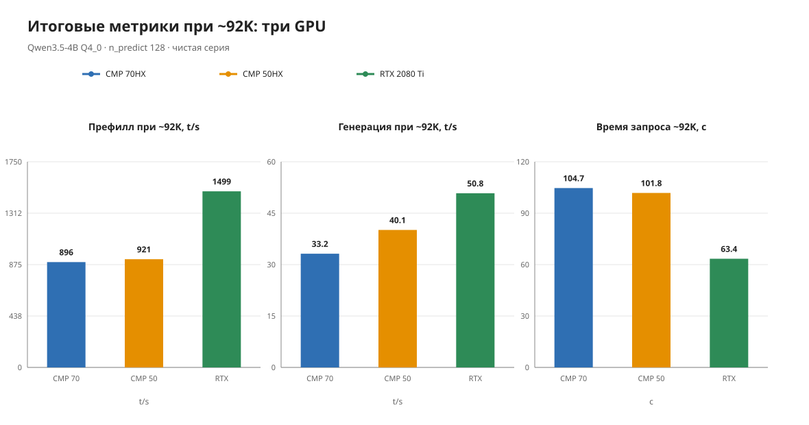
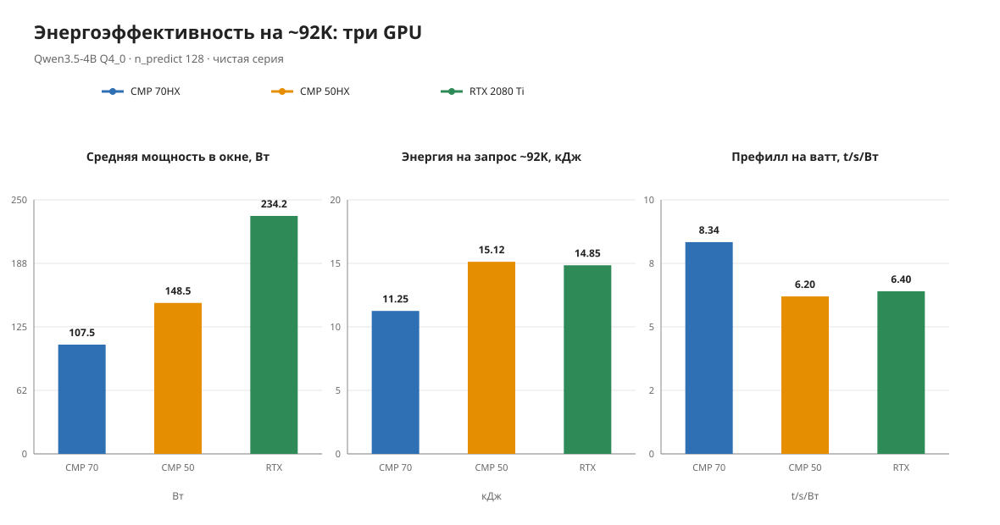

# Qwen3.5-4B (Q4_0 + vision): контекст 128K и сравнение CMP 70HX / CMP 50HX / RTX 2080 Ti

**Русский** | [English](README.en.md)

## ⚠️ Дисклеймер

Кейс содержит только измерения, описания и собственные скрипты. Веса модели и
mmproj **не включены** — публикуются только sha256. Чужие бинарники и чужие
скрипты в поставку не входят. Разблокировка CMP 70HX — в отдельном репозитории
[inference-cmp70-tuning](https://github.com/Manglobite/inference-cmp70-tuning);
здесь используется уже разлоченная карта.

## Цель

Проверить гибридную Qwen3.5-4B (Gated DeltaNet + full attention) на разлоченной
CMP 70HX: сколько контекста влезает при Q4-модели и KV q8_0, как деградирует
prefill/gen, какая телеметрия у узкого однокарточного прогона.

## Главный вывод

`--ctx-size 131072` с загруженным vision-проектором влезает в 8 ГиБ карты с
запасом ~1.6 ГиБ: пик VRAM 6518 МиБ из 8192. Prefill падает с 1674.52 t/s на
~9.6K токенов до 896.32 t/s на ~91.8K; генерация — с 61.28 до 33.17 t/s. Пики
52 °C и 141.06 Вт, 0 ошибок.

В чистой серии RTX 2080 Ti самый быстрый (prefill ×1.67 и gen
×1.53 к CMP 70HX на ~92K), CMP 70HX самый эффективный по ваттам
(8.34 t/s/Вт) и холодный (52 °C), CMP 50HX близок по скорости к CMP 70HX, но
~1.4× прожорливее.

## Стенд и софт

- GPU: **NVIDIA CMP 70HX 8 ГиБ** (разлочена, см. репозиторий
  [inference-cmp70-tuning](https://github.com/Manglobite/inference-cmp70-tuning)).
- Драйвер 610.43.03, ядро 7.0.0-34-generic.
- Рантайм: llama.cpp, commit **df03399**.
- Модель: `Qwen3.5-4B-Q4_0.gguf` — 2 583 221 408 Б,
  sha256 `298fcb5fe7a77ccc79745ae24751560c5ac56874caff4bb39b1f2055bd72b8bb`.
- Проектор: `mmproj-Qwen3.5-4B-F16.gguf` — 672 423 616 Б,
  sha256 `cd88edcf8d031894960bb0c9c5b9b7e1fea6ebee02b9f7ce925a00d12891f864`.
- Веса не публикуются; в кейсе только провенанс (размер и sha256).

## Конфигурация запуска

- Одна карта: CMP 70HX (CUDA0).
- `--ctx-size 131072`, `--cache-type-k q8_0 --cache-type-v q8_0`.
- `--mmproj` + `--mmproj-device CUDA0`.
- `-ngl all`, flash-attn, ubatch 448, порт 8087.
- Native-максимум модели — 262 144; KV/token ≈17 КиБ в q8_0 благодаря гибриду:
  всего 8 full-attention слоёв из 32 (4 KV-головы × head_dim 256).

## Результаты: лесенка

| target | prompt_n | prompt t/s | predicted_n | predicted t/s | wall |
| ---: | ---: | ---: | ---: | ---: | ---: |
| 0 | 10 | 27.68 | 128 | 61.28 | 2.44 |
| 10000 | 9650 | 1674.52 | 87 | 56.25 | 7.74 |
| 20000 | 18868 | 1584.52 | 79 | 52.47 | 13.53 |
| 30000 | 28086 | 1457.20 | 81 | 48.97 | 21.12 |
| 40000 | 37304 | 1341.47 | 82 | 45.76 | 29.77 |
| 20000 | 18868 | 1581.66 | 79 | 52.29 | 13.57 |
| 100000 | 91774 | 896.32 | 62 | 33.17 | 104.66 |

Чистая серия 06.10.2026, прогон `cmp70`, 217 сэмплов телеметрии, 0 ошибок.





## Системная телеметрия

- Сэмплов: 217.
- GPU util: max 100%.
- Температура GPU: max 52 °C.
- Мощность GPU: max 141.06 Вт (средняя в окне ~100K — 107.53 Вт).
- VRAM: max 6518 МиБ.
- CPU load average: max 1.34; температура CPU max 43 °C.
- RAM: max 4.78 из 32.9 ГиБ.
- Клоки: 1545 МГц ядро / 9501 МГц память.



*CMP 70HX.*



*CMP 50HX.*



*RTX 2080 Ti.*

## Сравнение GPU: CMP 70HX / CMP 50HX / RTX 2080 Ti

Чистая серия: три последовательных запуска подряд (с restart, без сторонних
нагрузок), одинаковые модель/контекст 131072/KV q8_0/vision/
промпты/телеметрия; карты по очереди.

| Метрика | CMP 70HX | CMP 50HX | RTX 2080 Ti |
| --- | ---: | ---: | ---: |
| Prefill @ ~9.6K, t/s | 1674.52 | 2000.77 | 2957.14 |
| Prefill @ ~37.3K, t/s | 1341.47 | 1489.83 | 2263.17 |
| Prefill @ ~91.8K, t/s | 896.32 | 920.77 | 1498.54 |
| Генерация @ ~9.6K, t/s | 56.25 | 59.48 | 89.70 |
| Генерация @ ~91.8K, t/s | 33.17 | 40.11 | 50.81 |
| Время ~100K-запроса, с | 104.66 | 101.81 | 63.41 |
| Средняя мощность в окне ~100K, Вт | 107.53 | 148.55 | 234.16 |
| Энергия на ~100K, кДж | 11.25 | 15.12 | 14.85 |
| Prefill@92K на ватт, t/s/Вт | 8.34 | 6.20 | 6.40 |
| Пиковая температура, °C | 52 | 55 | 66 |









## Ограничения и оговорки

- Фактический `prompt_n` на 4–8% ниже target — особенность харнесса, принято
  как есть (target задаёт объём запрошенного префикса, а не точный счёт).
- Ответы короткие (останавливаются по EOS, `predicted_n` 62–128), поэтому
  gen-числа получены на коротких хвостах и не являются длинным decode-бенчем.
- Контекст 256K не тестировался.
- Vision-вход не тестировался: проектор загружен, но изображения не подавались.
- Сравнение с 7B — в другом кейсе.
- Сравнение GPU — единая серия (три последовательных запуска), при этом карты
  разных архитектур (sm_86 vs sm_75) и с разными TDP; средняя мощность — в окне
  ~100K-запроса (util ≥ 90); CMP 50HX разлочен; RTX стоковый.

## Структура кейса

```text
qwen35-4b/
├── README.md / README.en.md     <- этот файл (RU, по умолчанию) и английская версия
├── LICENSE-NOTICE.md            <- что не включено в поставку
├── data/
│   ├── prefill-vs-context.ru.svg
│   ├── gen-vs-context.ru.svg
│   ├── system-telemetry-cmp70.ru.svg
│   ├── system-telemetry-cmp50.ru.svg
│   ├── system-telemetry-rtx.ru.svg
│   ├── prefill-vs-context-3gpu.ru.svg
│   ├── gen-vs-context-3gpu.ru.svg
│   ├── throughput-summary-3gpu.ru.svg
│   ├── energy-efficiency-3gpu.ru.svg
│   ├── prefill-vs-context.en.svg
│   ├── gen-vs-context.en.svg
│   ├── system-telemetry-cmp70.en.svg
│   ├── system-telemetry-cmp50.en.svg
│   ├── system-telemetry-rtx.en.svg
│   ├── prefill-vs-context-3gpu.en.svg
│   ├── gen-vs-context-3gpu.en.svg
│   ├── throughput-summary-3gpu.en.svg
│   └── energy-efficiency-3gpu.en.svg
└── scripts/
    └── check-public.sh          <- барьер публикации
```

## Публикация

`bash scripts/check-public.sh` → OK. В кейсе только относительные пути; веса
модели и проектор присутствуют исключительно в виде sha256. Барьер
`scripts/check-public.sh` проверяет не только приватные маркеры (пути, IP/hosts,
session ID, ключи), но и **инвентарь**: допускаются только README (RU/EN),
LICENSE-NOTICE.md, .gitignore, scripts/check-public.sh и `data/*.svg`; публичная
ссылка на репозиторий кейса-компаньона разрешена точечно. Есть самотест:
`python3 scripts/check-public-selftest.py` (в корневом `scripts/`).
